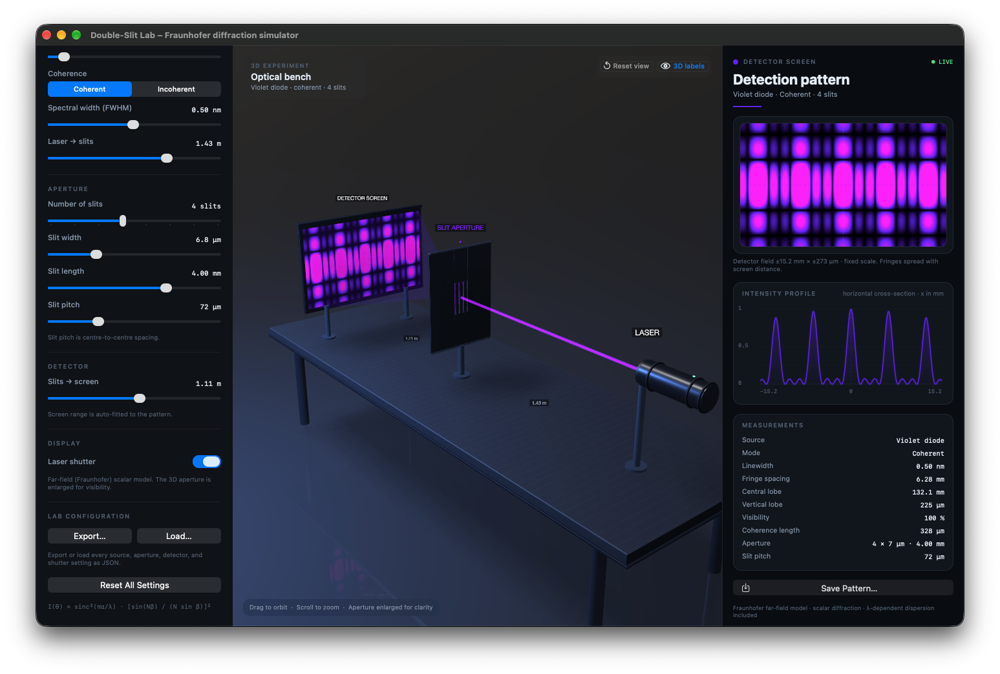

# Double-Slit Lab

An interactive, native macOS simulator for the classic Young's double-slit (and multi-slit) optical diffraction and interference experiment. 

Rendered with **SceneKit** for an interactive 3D optical bench and powered by a scalar **Fraunhofer diffraction** and **CIE 1931 color science** engine, Double-Slit Lab simulates physical wave and particle propagation, coherence, and spectral dispersion in real time.



---

## Features

### 🔬 Real-Time Optical Simulation
- **Multi-Slit Configurations**: Configure from 1 up to 8 slits with independent control over slit width ($a$), slit pitch ($d$), and slit length ($L$).
- **Laser Sources & Presets**: Built-in calibrated sources including:
  - **He–Ne Laser** (632.8 nm)
  - **Argon Ion ($Ar^+$) Laser** (488.0 nm)
  - **DPSS Green Laser** (532.0 nm)
  - **Violet Diode** (405.0 nm)
  - **Red Diode** (650.0 nm)
  - **Broadband White Light** (6500 K Planck blackbody spectrum)
  - **Custom Spectral Source**: Interactive color well that maps RGB selections to the nearest monochromatic spectral locus or white light.
- **Coherence Modes**:
  - **Coherent**: Computes electric field amplitude summation across all slits, yielding high-contrast interference fringes modulated by single-slit envelopes.
  - **Incoherent**: Integrates intensity independently from each slit, eliminating phase interference and illustrating pure diffraction envelopes.
- **Spectral Linewidth & Dispersion**: Adjustable FWHM linewidth ($\Delta\lambda$) with multi-wavelength Gaussian sampling to observe chromatic dispersion and visibility loss.
- **Optical Bench Geometry**: Independently vary laser-to-aperture distance and aperture-to-screen distance ($D$) to observe geometric spreading.
- **Laser Shutter**: Toggle the optical beam shutter to observe beam extinction and dark detector states.

### 🖥️ Interactive 3D Optical Bench
- **SceneKit 3D Bench**: Real-time rendering of optical rails, laser housing, aperture mounts, propagation diffraction fan, and detector screen.
- **Camera Controls**: Free 3D orbit, zoom, and pan.
- **Reset View**: Dedicated camera reset button (`⌘0`) to instantly return the camera to the optimal framing of the optical bench.
- **3D Measurement Labels**: Toggleable physical measurement annotations in 3D space (`⌘L`).

### 📊 Detector Analysis & Measurements
- **Live 2D Detector Pattern**: 1000 × 600 high-resolution physical detector screen rendering.
- **Fixed Detector Scale**: Preserves absolute physical dimensions on the detector so fringes naturally expand and contract as screen distance varies.
- **Intensity Profile Chart**: Real-time cross-sectional intensity profile $I(x)$ along the central horizontal axis.
- **Derived Physical Metrics**:
  - **Fringe Spacing** ($\Delta x \approx \frac{\lambda D}{d}$)
  - **Central Diffraction Lobe Width** ($2\frac{\lambda D}{a}$)
  - **Vertical Envelope Height** ($2\frac{\lambda D}{L}$)
  - **Interference Visibility** ($V = \frac{I_{\max} - I_{\min}}{I_{\max} + I_{\min}}$)
  - **Coherence Length** ($L_c \approx \frac{\lambda^2}{\Delta\lambda}$)
- **High-Resolution PNG Export**: Export current detector pattern images directly to disk.
- **Lab Configuration Files**: Export the complete source, aperture, detector, and shutter state to a human-readable JSON file, then load it again to restore the bench (`⇧⌘E` / `⌘O`).

---

## Physics Engine

The simulation models scalar far-field Fraunhofer diffraction for an array of $N$ rectangular slits:

1. **Diffraction Angles**:
   $$u = \frac{x}{\sqrt{x^2 + D^2}} \approx \sin\theta, \quad v = \frac{y}{\sqrt{y^2 + D^2}} \approx \sin\phi$$

2. **Single-Slit Envelope**:
   $$I_{\text{env}}(u, v) = \text{sinc}^2\left(\frac{\pi a u}{\lambda}\right) \cdot \text{sinc}^2\left(\frac{\pi L v}{\lambda}\right)$$
   where $\text{sinc}(z) = \frac{\sin(z)}{z}$ with $\text{sinc}(0) = 1$.

3. **Multi-Slit Interference Factor** ($N$ slits with center-to-center pitch $d$):
   $$I_{\text{int}}(u) = \left[ \frac{\sin\left(\frac{N \pi d u}{\lambda}\right)}{N \sin\left(\frac{\pi d u}{\lambda}\right)} \right]^2$$

4. **Coherent vs. Incoherent Intensity**:
   - **Coherent**: $I(u, v) = I_{\text{env}}(u, v) \cdot I_{\text{int}}(u)$
   - **Incoherent**: $I(u, v) = I_{\text{env}}(u, v)$ (summing slit intensities removes phase interference)

5. **Spectral Integration & Colorimetry**:
   - Polychromatic and finite-linewidth sources are integrated over sampled wavelengths:
     $$\mathbf{C} = \int S(\lambda) I_\lambda(x, y) \begin{bmatrix} \bar{x}(\lambda) \\ \bar{y}(\lambda) \\ \bar{z}(\lambda) \end{bmatrix} d\lambda$$
   - CIE XYZ values are mapped into standard linear sRGB color space and gamma-corrected for display.

---

## Architecture & Technology Stack

- **Platform**: macOS 13.0+ (Ventura and later)
- **Language**: Objective-C (ARC enabled, GNU17 standard)
- **Frameworks**:
  - `AppKit`: Programmatic Auto Layout, custom controls, dark theme styling.
  - `SceneKit`: 3D optical bench graphics, physical lighting, materials, and camera control.
  - `QuartzCore`: Animation transactions and layer presentation.
  - `UniformTypeIdentifiers`: Modern system file export handling.
- **Dependencies**: Zero runtime dependencies. No third-party packages or Swift runtime overhead.

```
DoubleSlitLab/
├── App/
│   └── DSAppDelegate.{h,m}          # Application lifecycle and main menu setup
├── Model/
│   ├── DSExperimentParameters.{h,m} # Experiment configuration, validation, presets
│   ├── DSLabConfiguration.{h,m}     # JSON export/import of the complete bench state
│   ├── DSColorScience.{h,m}         # CIE 1931 standard observer table, XYZ → sRGB
│   └── DSPhysicsEngine.{h,m}        # Fraunhofer diffraction, metrics, spectral integration
├── Scene/
│   └── DSSceneController.{h,m}      # 3D optical bench geometry, lighting, camera
├── UI/
│   ├── DSMainViewController.{h,m}   # Three-pane layout coordination, debounce rendering
│   ├── DSControlsViewController.{h,m}# Laser, aperture, and bench geometry controls
│   ├── DSStageViewController.{h,m}  # 3D SceneKit viewport, HUD overlays, camera controls
│   ├── DSResultsViewController.{h,m}# Detector pattern, intensity chart, measurements
│   ├── DSTheme.{h,m}                # Color palette, typography, visual styling
│   └── Components/
│       ├── DSLabeledSlider.{h,m}    # Parameter slider row component
│       └── DSPatternView.{h,m}      # 2D detector card and intensity profile view
DoubleSlitLabTests/
└── DSPhysicsEngineTests.m           # Unit tests for physics, colorimetry, and configuration files
```

---

## Building and Running

### Prerequisites
- macOS 13.0 or higher
- Xcode 15 or higher with Command Line Tools installed
- Optional: [XcodeGen](https://github.com/yonaskolb/XcodeGen) (`brew install xcodegen`) if modifying `project.yml`

### Build & Run via Terminal

```bash
# Optional: Regenerate the Xcode project if project.yml changed
xcodegen generate

# Build Debug target locally
xcodebuild -project DoubleSlitLab.xcodeproj \
  -scheme DoubleSlitLab \
  -configuration Debug \
  -derivedDataPath build \
  CODE_SIGNING_ALLOWED=NO build

# Launch the application
open build/Build/Products/Debug/DoubleSlitLab.app
```

### Running Unit Tests

```bash
xcodebuild -project DoubleSlitLab.xcodeproj \
  -scheme DoubleSlitLab \
  -configuration Debug \
  -derivedDataPath build \
  CODE_SIGNING_ALLOWED=NO test
```

---

## License

This project is released under the MIT License.
